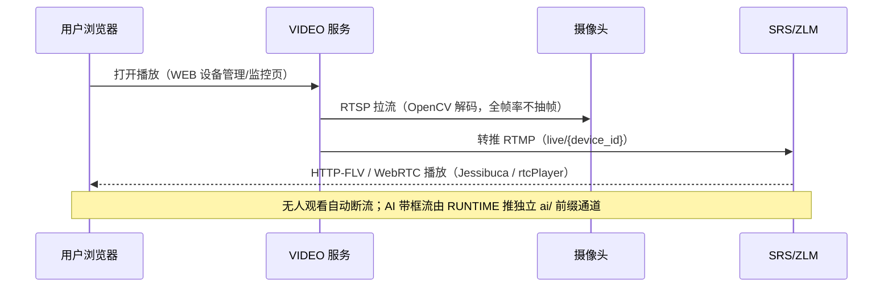
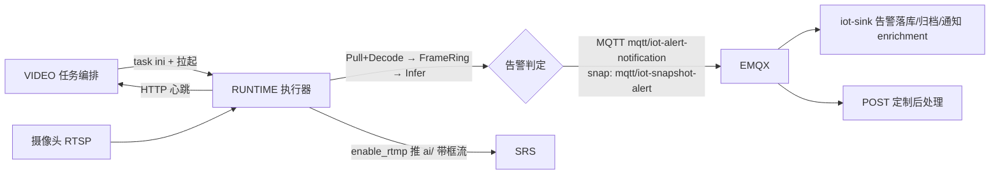
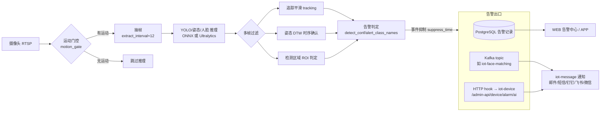
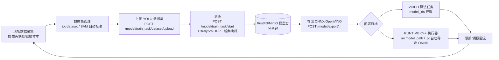
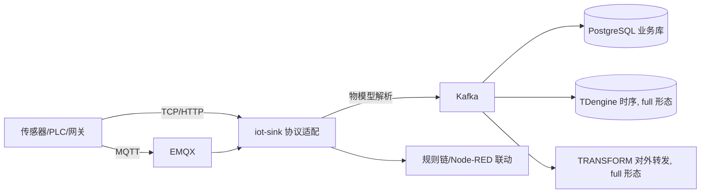
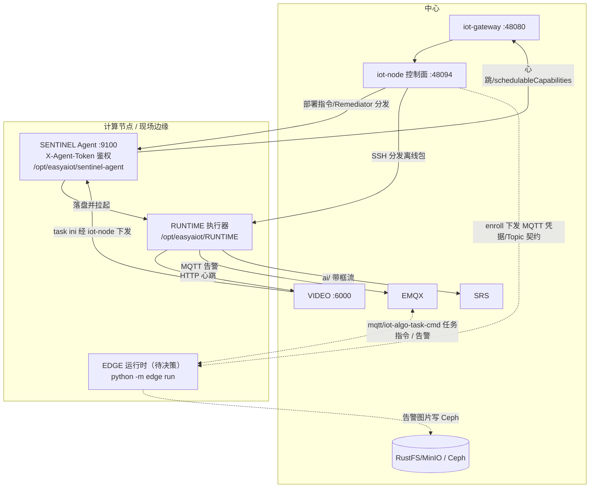

# yFeiEye 整体架构详解

> 整理日期：2026-08-04；2026-10-20 按仓库实况修订（模块集合、部署规格、边缘组件、对象存储、CI）。本文从"云-边-端"视角梳理 yFeiEye（AIoT 算法应用平台）的整体架构、模块职责、核心数据流与部署形态，附 Mermaid 流程图。同目录 `项目架构设计分析.md`（2026-05-31）侧重技术栈与完成度评估，本文侧重**运行时拓扑与数据流**，两者互补；面向 AI 编码代理的速查见根目录 `AGENTS.md`。

---

## 1. 一句话定位

yFeiEye 是一个**云-边-端一体化的 AIoT 平台**：设备/摄像头接入 → 数据采集与实时视频 AI 分析 → 智能研判 → 告警处置 → 模型训练迭代的完整闭环。仓库是**由多个相互独立项目组成的 monorepo**：21 个受版本控制的模块目录（另有 `docs/`、`testdata/`、`tools/`）。主力语言为 Java（控制底座）、Python（AI、视频编排、节点 Agent）、C++（高性能帧执行器）、TypeScript/Vue（前端），另有 Go（POST、TERMINAL、RTC 集成的 go2rtc）与 C#（EDGE 采集器）。

> 历史名称对照：原节点 Agent 模块已迁到 `SENTINEL/`，原 C++ 推理模块（含 TaskManager）已演进为 `RUNTIME/`。旧版本文档中的 NODE / TASK 均按此理解。

## 2. 总体架构图

```mermaid
flowchart TB
    subgraph END["端（设备层）"]
        CAM["摄像头<br/>RTSP / ONVIF / GB28181 / NVR"]
        CCAM["消费级摄像头<br/>Tapo / Tuya / Ring / 小米 ..."]
        IOT["IoT 设备/传感器<br/>MQTT / TCP / HTTP / Modbus / OPC-UA"]
    end

    subgraph EDGELAYER["边（边缘层 / 计算节点）"]
        SEN["SENTINEL 节点 Agent<br/>Python Flask · :9100<br/>组件探测 / 心跳 / 拉起工作负载"]
        RT["RUNTIME 帧执行器<br/>C++17 · ONNX Runtime / FFmpeg<br/>拉流→推理→MQTT 告警"]
        EDGEMOD["EDGE（去留待决策）<br/>python -m edge + C# 采集器<br/>全 MQTT"]
    end

    subgraph CLOUD["云（中心平台）"]
        subgraph FRONT["前端"]
            WEB["WEB 控制台<br/>Vue3+Vite · :8888"]
            APP["APP 移动端<br/>uni-app · :9010"]
            VIS["VISUALIZE 可视化编辑器 · :8002"]
        end

        GW["iot-gateway API 网关<br/>Spring Cloud Gateway · :48080"]

        subgraph JAVA["DEVICE Java 微服务群（Spring Cloud + Nacos）"]
            SYS["iot-system :48099<br/>系统/权限/OAuth2"]
            DEV["iot-device :48083<br/>产品/设备/物模型/OTA"]
            INFRA["iot-infra 基础设施"]
            DS["iot-dataset :48087 数据集"]
            MSG["iot-message :48093 消息推送"]
            FILE["iot-file 文件"]
            SINK["iot-sink :48092<br/>协议接入/数据汇流/告警落库"]
            GB["iot-gb28181 :48088<br/>国标 SIP 信令"]
            NODESVC["iot-node :48094<br/>节点控制面"]
            VISSVC["iot-visualize :48095"]
            FLOW["iot-flow :48097 流程"]
            TD["iot-tdengine 时序集成"]
        end

        subgraph SVC["Python / Go / Java 业务服务"]
            AI["AI model-server :5000<br/>训练/推理/导出/部署"]
            VIDEO["VIDEO :6000<br/>摄像头接入/流媒体编排<br/>算法任务/告警/录像"]
            RTC["RTC :6100<br/>go2rtc 协议桥接"]
            POST["POST :8089<br/>Go 定制后处理"]
            TRANSFORM["TRANSFORM :48096<br/>系统对接/数据转发"]
        end

        subgraph MW["中间件"]
            NACOS["Nacos :8848"]
            PG[("PostgreSQL 多业务库")]
            REDIS[("Redis")]
            KAFKA[["Kafka"]]
            OSS[("RustFS/MinIO<br/>S3 :9000/9001")]
            MILVUS[("Milvus 人脸向量库")]
            EMQX[["EMQX MQTT"]]
            SRS["SRS :1935/8080/8000"]
            ZLM["ZLMediaKit"]
            TDE[("TDengine（full）")]
        end
    end

    CAM -->|RTSP/GB28181| VIDEO
    CAM -->|GB28181 SIP| GB
    CCAM -->|P2P/私有协议| RTC
    RTC -->|RTSP/WebRTC| VIDEO
    IOT -->|MQTT| EMQX
    EMQX --> SINK
    IOT -->|TCP/HTTP| SINK
    SINK --> KAFKA
    SINK --> PG
    SINK --> TDE

    WEB --> GW
    APP --> GW
    GW --> JAVA
    WEB -.->|直连代理| AI
    WEB -.->|直连代理| VIDEO

    VIDEO <-->|原画 live/| SRS
    VIDEO <-->|GB 流| ZLM
    VIDEO -->|告警事件/人脸匹配| KAFKA
    VIDEO -->|快照/录像/人脸图| OSS
    VIDEO -->|人脸向量| MILVUS
    KAFKA --> DEV
    KAFKA --> MSG
    KAFKA --> TRANSFORM

    VIDEO -->|生成 ini 并拉起| RT
    RT -->|HTTP 心跳| VIDEO
    RT -->|MQTT 告警| EMQX
    RT -->|带框流 ai/| SRS
    EMQX <-->|推理事件/最终告警| POST

    AI <-->|数据集/模型文件| OSS
    DS -.->|标注数据| AI
    AI -->|ONNX 模型| VIDEO
    AI -->|ONNX 模型| RT

    SEN -->|心跳/可调度能力 经网关| NODESVC
    NODESVC -->|部署指令/自愈分发| SEN
    NODESVC -->|SSH 分发 RUNTIME| RT
    NODESVC -.->|enroll 下发 MQTT 凭据| EDGEMOD
    EMQX <-.->|任务指令/告警| EDGEMOD
```

说明：

- VIDEO 本机与计算节点上的 RUNTIME 是同一个二进制；中心机由 VIDEO 安装时编译挂载，计算节点由 iot-node 分发或 `edge/integrated` 独立安装。
- RUNTIME 的告警默认走 MQTT（`mqtt/iot-alert-notification`，抓拍为 `mqtt/iot-snapshot-alert`）→ iot-sink 落库；心跳仍走 HTTP → VIDEO。纯边缘形态（`edge/standalone`）不部署 EMQX，告警改走 HTTP（`/video/alert/hook`）。
- EDGE 以虚线表示：其与 RUNTIME 的关系尚未定论，见第 5.5 节。

## 3. 模块职责一览

### 3.1 核心平台模块（出现在 `deploy-profiles.json` 的规格模块列表中）

| 模块 | 技术栈 | 定位 | 关键端口 | 部署规格 |
|---|---|---|---|---|
| `DEVICE/` | Java 21 + Spring Boot 2.7.18 + Spring Cloud 2021.0.5 + Nacos | 平台控制底座：网关、系统、设备/产品/物模型、节点控制面、GB28181、消息、数据汇流（15 个 Maven 模块，13 个微服务） | 网关 48080 | mini / standard / full |
| `AI/` | Python + Flask + PyTorch + Ultralytics/SAM/PaddleOCR | 模型训练/推理/导出/部署（model-server） | 5000 | mini / standard / full |
| `VIDEO/` | Python + Flask + OpenCV + insightface/pymilvus | 摄像头接入、视频流、算法任务编排、告警、录像；拉起 RUNTIME | 6000 | edge / mini / standard / full |
| `WEB/` | Vue 3 + Vite + TS + ant-design-vue + Pinia（pnpm） | PC 管理控制台（nginx 同时托管 SITE） | 8888 | edge / mini / standard / full |
| `RTC/` | go2rtc + Python Flask 管理服务 | 消费级摄像头 P2P/私有协议桥接 | 6100 | standard / full |
| `POST/` | Go | 推理事件定制后处理（MQTT 订阅推理事件/告警，产出最终告警） | 8089 | standard / full |
| `APP/` | uni-app（unibest）+ Vue 3 + Wot Design Uni | 移动端 H5/小程序/App | dev 9000 / 部署 9010 | full |
| `VISUALIZE/` | Vue 3 + Vite | 低代码可视化大屏编辑器（后台 iot-visualize） | 8002 | full |
| `TRANSFORM/` | Java 21 + Spring Boot（consume/map/deliver 等能力 + HTTP/JDBC/Kafka/MQTT 通道） | 系统对接 / 数据转发 | 48096 | full |

### 3.2 边缘执行组件（不在规格模块列表中，由安装流程或控制面拉起）

| 模块 | 技术栈 | 定位 | 关键端口 |
|---|---|---|---|
| `RUNTIME/` | C++17 + CMake + OpenCV 5 / ONNX Runtime / FFmpeg | C++ 帧执行器（由原 TASK 演进），`task_type` 支持 realtime / snap / patrol；不替代 VIDEO；附兼容用 TaskManager | 任务控制口 8000–9000；TaskManager 127.0.0.1:7000 |
| `SENTINEL/` | Python 3（兼容 3.9）+ Flask | 集群节点观察者 Agent：按功能探测组件、经网关上报 iot-node、执行部署指令、请求自愈 | 9100 |
| `EDGE/` | Python（`python -m edge`）+ C# .NET 8 采集器（Modbus / OPC UA） | 无界面边缘算法运行时 + 工业采集；**去留待决策**（见 5.5） | 纯 MQTT |

### 3.3 周边 / 实验性模块

| 模块 | 定位 | 端口 | 启用方式 |
|---|---|---|---|
| `HARNESS/` | 平台 AI Agent 助手（基于 DeepSeek Harness，实验） | 3080 / 3082 | `EASYAIOT_ENABLE_HARNESS` |
| `IDEA/` | 社区贡献在线 IDE（code-server + 门户） | 9300（工作区 13338–13437） | `EASYAIOT_ENABLE_IDEA` |
| `TERMINAL/` | 多协议终端与远程运维客户端（Go + Wails，源自 uniTerm） | 9245 | `EASYAIOT_ENABLE_TERMINAL` |
| `TWIN/` | 工业园区数字孪生 MVP（Three.js） | 8003 | `EASYAIOT_ENABLE_TWIN` |
| `PANEL/` | 独立运维控制台（容器/部署/诊断） | 9200 | `EASYAIOT_ENABLE_PANEL` |
| `COMPILE/` | 把 PANEL（及 EDGE 等）打成 deb/rpm/exe/dmg | — | 手工 / GitHub 手动 workflow |
| `SITE/` | 官方网站（纯前端） | 8090 | 独立安装或挂进 WEB 容器 |
| `ANDROID/`、`IOS/`、`HARMONYOS/` | APP 构建产物的移动端壳工程（APK / IPA / HAP） | — | 各自打包脚本 |

## 4. 部署形态（四档规格 + edge 双形态）

部署规格的**单一事实源**是 `.scripts/docker/deploy-profiles.json`，由 `generate-deploy-profiles.mjs` 生成 `deploy-profiles.generated.sh`（`deploy_profile.sh` 读取）与 WEB 侧清单；通过 `EASYAIOT_DEPLOY_PROFILE=edge|mini|standard|full`（默认 full）选择：

| 形态 | 内存 | 业务模块 | 中间件 | DEVICE 微服务 |
|---|---|---|---|---|
| **edge** 纯边缘 | ≥2GB | VIDEO、WEB | PostgreSQL、Redis、SRS | 无 |
| **mini** 边缘精简版 | ≥4GB | DEVICE、AI、VIDEO、WEB | Nacos、PostgreSQL、Redis、Kafka、RustFS/MinIO、SRS、EMQX | iot-gateway、iot-system、iot-infra、iot-sink |
| **standard** 标准版 | ≥16GB | 再加 RTC、POST | 再加 Milvus、ZLMediaKit | 再加 iot-dataset、iot-node、iot-flow、iot-file、iot-message、iot-gb28181 |
| **full** 完整版（默认） | ≥20GB | 再加 APP、VISUALIZE、TRANSFORM | 再加 TDengine、Node-RED、FUXA | 全部 13 个（再加 iot-device、iot-visualize、iot-tdengine） |

edge 规格在安装时再选子形态（`EASYAIOT_EDGE_MORPHOLOGY`）：

- `standalone`（默认）：汇聚面（VIDEO + WEB）与 RUNTIME 同机闭环，告警图/录像落本地，不部署 EMQX，告警走 HTTP。
- `integrated`（云边一体）：本机只装 RUNTIME 算力节点，接入远端中心的 VIDEO / Gateway / EMQX，需 `VIDEO_BASE_URL`；安装流程委托 `RUNTIME/install_linux.sh integrated`。

HARNESS、IDEA、TERMINAL、TWIN、PANEL 及 GPUStack 不属于任何规格，用对应 `EASYAIOT_ENABLE_*` 环境变量显式开启。

统一部署入口：`.scripts/docker/install_linux.sh`（先 `install_middleware_linux.sh install` 起中间件，再起业务模块）。

## 5. 核心流程详解

### 5.1 视频观看链路（按需拉流）

要点：观看链路与 AI 链路解耦；WEB 端 Jessibuca（HTTP-FLV，0.8~2s）或 WebRTC（0.3~0.8s）；GB28181 摄像头经 ZLM `rtp_proxy` 出 FLV（1~3s）。

### 5.2 AI 实时分析与告警链路

算法任务默认 `executor=cpp`：VIDEO 生成 `config/task_{id}.ini` 并拉起 RUNTIME；可选 `executor=python` 走 VIDEO 内置 Python 流水线。

`executor=python` 时 VIDEO 内部的检测与过滤流程如下：

要点：告警与页面播放完全无关，服务端常驻；人脸识别是"检测(face_det.onnx)+特征(face_rec.onnx)+Milvus 向量比对"，阈值三级覆盖（任务 > 人脸库 > env）；摔倒检测走 YOLO Pose 关键点 + 规则模板/DTW 多帧确认。

### 5.3 模型训练→部署闭环

### 5.4 IoT 设备数据链路

### 5.5 边缘拓扑（SENTINEL / RUNTIME / EDGE）

- **SENTINEL**：节点纳管后由 iot-node SSH 同步并装为 systemd 服务；`NODE_FUNCTIONS`（如 `algorithm,forward,live`）决定期望组件；首次 L1 扫描，之后心跳 L0 + 周期 L1；远程节点 `PLATFORM_AGENT=0` 不可改为 1。
- **RUNTIME 云边一体**：`install` → `edge` → `integrated`（或 `RUNTIME/install_linux.sh integrated <VIDEO_URL>`）在节点上安装算力；批量节点用 WEB「业务运行时分发」。RUNTIME 安装受 OS 矩阵限制（`RUNTIME/scripts/runtime_os_matrix.sh`）。
- **EDGE 与 RUNTIME 的关系：待决策。** 两份 README 互相矛盾：
  - `RUNTIME/README.md` 写"原 EDGE 模块已移除，边缘算力请用云边一体（integrated / atomic）"；
  - `EDGE/README.md` 与 `EDGE/docs/EDGE_MODULE_DESIGN.md` 仍自称"第八核心模块"，设计约束为无界面、全 MQTT（无 Kafka/HTTP 管理面）、边缘零本地业务盘、与 VIDEO 源码解耦；2026-08-12 还新增了 C# 采集器（`EDGE/EasyAIoT.Edge.sln`）。
  - 代码层面 EDGE 仍被引用：DEVICE iot-node 的 EDGE 登记接口（`EdgeNodeController`）、WEB 的 EDGE 接入引导抽屉、`COMPILE/pack_edge.sh`；但它不在 `deploy-profiles.json` 的任何规格中。
  - 在决策落地前，本文不认定 EDGE 已废弃或仍是主路径；新的边缘算力能力以 RUNTIME 云边一体为准。

## 6. 端口速查

| 端口 | 服务 | 端口 | 服务 |
|---|---|---|---|
| 8888 | WEB（容器 443） | 8848 | Nacos |
| 9000 / 9010 | APP dev / 部署 | 9000/9001 | RustFS/MinIO S3/Console（绑 127.0.0.1） |
| 48080 | API 网关（SENTINEL 经此上报 iot-node） | 5432 | PostgreSQL |
| 48088 | iot-gb28181 | 6379 | Redis |
| 48094 | iot-node 控制面 | 9092 | Kafka |
| 48099 | iot-system | 1935/8080/8000 | SRS RTMP/HTTP/WebRTC |
| 5000 | AI model-server | 6080/10935/10000/8001 | ZLM HTTP/RTMP/RTP/WebRTC |
| 6000 | VIDEO | 1883/8883 | EMQX MQTT |
| 6100 | RTC 管理 API（go2rtc 1984） | 6030 | TDengine |
| 8089 | POST | 8002 | VISUALIZE |
| 48096 | TRANSFORM | 8090 | SITE |
| 9100 | SENTINEL Agent | 7000 | RUNTIME TaskManager（127.0.0.1） |
| 8000–9000 | RUNTIME 任务控制口（示例 8123） | 3080 / 9300 / 9245 / 8003 / 9200 | HARNESS / IDEA / TERMINAL / TWIN / PANEL |

## 7. 关键设计决策与约定

- **观看/分析双链路分离**：页面不开播不影响 AI 告警；原画走 `live/{device_id}`，AI 带框流走独立 `ai/{device_id}`。
- **编排与执行分离**：VIDEO 负责编排、预览、任务生命周期与心跳接收；RUNTIME 只做帧执行，告警走 MQTT 算法总线 → iot-sink。
- **部署规格单一事实源**：模块/中间件/微服务/WEB 能力按规格的取舍只在 `deploy-profiles.json` 中维护，安装脚本与 WEB 读取生成物。
- **告警即事件**：检测→多帧确认（追踪/DTW/ROI/抑制）→ 告警事件 → MQTT/Kafka/HTTP/通知出口。司法监管业务的领域术语与合规约束见根目录 `CONTEXT.md` 与 `docs/adr/`（改动事件中心/告警/复测前必读）。
- **训练安全边界**：预训练模型白名单（官方 yolov8/11/26 命名），Web 侧只允许 `.onnx` 流转，防 pickle 反序列化。
- **数据库多库隔离**：PostgreSQL 按业务域分库（`ruoyi-vue-pro20`、`iot-ai20`、`iot-node20` 等）；VIDEO 迁移为 Flyway 风格带 checksum。
- **CI 现状**：`.github/workflows/pr-tests.yml` 在 PR 及推送 `main`/`dev` 时按改动路径跑 DEVICE、VIDEO、AI、WEB、`.scripts` 的测试；`.github/workflows/compile-packaging.yml` 为 `workflow_dispatch` 手动触发的 COMPILE 多平台打包。APP、RUNTIME、SENTINEL、POST、TERMINAL 尚未纳入 CI。各模块本地测试命令（DEVICE `mvn test`、AI/VIDEO pytest/unittest、WEB `tsx tests/*.test.ts`、SENTINEL/RUNTIME unittest、POST/TERMINAL `go test`、`.scripts` 下 `node --test`）。
- **现状风险**：主 compose（DEVICE、中间件、RUNTIME）已改为 `${VAR:?}` 读取密码，但 TRANSFORM compose 与 yaml、各模块 desktop compose / `env.example`、DEVICE iot-flow 的 local 配置等处仍有默认口令明文（勿扩散）；Spring Boot 2.7 已 EOL。

### 7.1 已知的文档与配置不一致（待修）

- `DEVICE/docker-compose.yml` 中 iot-node 的 Agent 源码卷挂载仍是迁移前的旧目录名，而 iot-node 代码按 `/opt/easyaiot/SENTINEL` 查找 Agent 源码。
- 对象存储：README / 部署文档与 `.scripts/docker/RUSTFS_MIGRATION.md` 写 RustFS，但中间件 compose 仍是 `minio/minio` 镜像、服务名 `MinIO`。容器内访问对象存储统一用服务名 `MinIO`（DEVICE compose 与 VIDEO/AI 的 env 模板、桌面端安装脚本已对齐），不要写 `RustFS` 主机名。
- EDGE 与 RUNTIME 的去留关系（见 5.5）。

## 8. 与既有文档的关系

- AI 编码代理速查（模块、命令、测试、安全）：根目录 `AGENTS.md`
- 部署规格清单：`.scripts/docker/deploy-profiles.json`
- 技术栈清单与完成度评估：`.doc/架构设计/项目架构设计分析.md`
- 部署操作：`.doc/部署文档/平台部署文档.md`、`.doc/部署文档/部署最佳实践.md`
- 边缘执行器细节：`RUNTIME/README.md`；节点 Agent：`SENTINEL/README.md`
- 领域术语与合规：`CONTEXT.md`、`docs/adr/`
- 设计工作流（spec/plan）：`docs/superpowers/`
